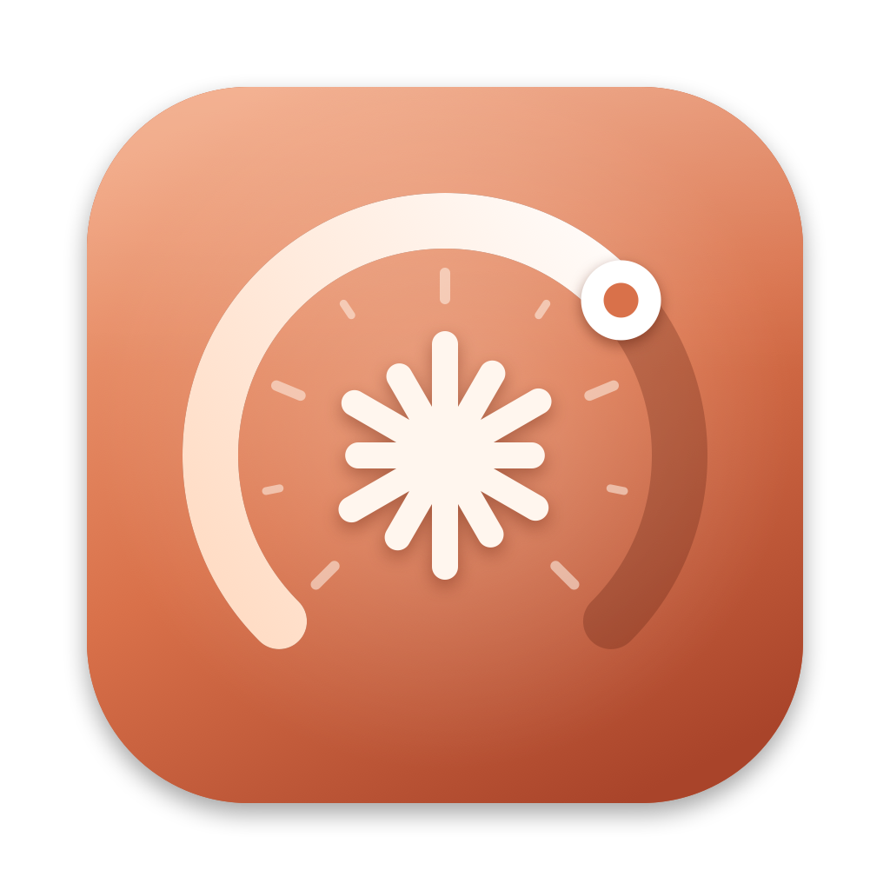

# Claude Usage

A small macOS menu bar app, and a `claude-usage` command, that shows how much of your Claude
subscription you have used and lists your open Claude Code sessions.



## Install

```sh
brew tap biks2013-tools/claude-usage
brew trust biks2013-tools/claude-usage   # newer Homebrew asks you to trust third-party taps
brew install --cask claude-usage
```

This installs the app in `/Applications` and the `claude-usage` command. Open **Claude Usage** once
to put its icon (a gauge around a spark) in the menu bar (and turn on **Open at Login** in its menu if you like).

## In the terminal

```sh
claude-usage                 # plan limits with reset times, the week by product, extra usage
claude-usage sessions        # open Claude Code sessions, numbered
claude-usage go 3            # go to session 3 (or: go tiler, go <session id>)
claude-usage usage --json    # the raw usage answer, for scripts
claude-usage sessions --json
```

## In the menu bar

Click the icon in the menu bar. The menu shows the last answer straight away, asks Anthropic, and
updates itself a moment later:

- **Plan**, e.g. *Claude Max 20x*.
- **Plan limits**: the current 5-hour session and the weekly limits (all models, and per model when
  your plan has one), each with a bar, the percentage used, and when it resets.
- **This week by product**: how the week's usage splits over Claude Code, chats, Cowork and others.
- **Beyond the plan**: extra usage (on or off, spend this month) and credits spent.

- **Claude Code sessions**: every Claude Code session open on this Mac, with its folder and what it
  is doing (orange: needs you, green: working, grey: idle). Choose one to go there.

Nothing runs in the background: the app asks Anthropic, and lists the sessions, only when you open
the menu.

## Going to a session

- **In a cmux tab:** cmux comes forward on that window, workspace and tab. If that window is on
  another desktop, you are taken there with your Mission Control shortcuts **Move left / right a
  space** (keep them on). This needs **Accessibility** for Claude Usage once: the first time, macOS
  asks; allow it in System Settings › Privacy & Security › Accessibility, then choose the session
  again. It is used only to find the cmux window.
- **In a tmux pane:** tmux selects that pane; the terminal attached to it comes forward. If no
  terminal is attached (for example the M365Mail app's agents), a new cmux workspace attaches to it.
  Closing that workspace only detaches; the session keeps running.
- **A background session:** a new cmux workspace opens it with `claude attach`.
- **Any other terminal:** that terminal app comes forward.

The list comes from `claude agents --json`; the app looks for `claude` in `~/.local/bin`,
`/opt/homebrew/bin` and `/usr/local/bin`.

**Not shown: the renewal date.** Anthropic does not give it to apps. **Billing and Renewal Date…**
opens the billing page on claude.ai, and **Open Usage on claude.ai** opens the usage page.

## How it gets the numbers

It uses your Claude Code sign-in. Claude Code keeps it in your login Keychain, so the first time
you open the menu macOS asks whether *Claude Usage* may use *Claude Code-credentials*: enter your
login password and choose **Always Allow**. The token is used only for that request and is never
saved or logged.

The numbers come from the same service Claude Code's `/usage` uses. Anthropic does not document
it, so it may change without notice; the app then shows what it still understands, or says the
format changed.

If Claude Code's sign-in has expired, the menu says so: run `claude` once and it renews it. The app
never renews it itself, because that would sign Claude Code out.

## Requirements

macOS 14 or later, and Claude Code signed in with a Pro or Max subscription.

## Build

```sh
swift test
CLAUDE_USAGE_SIGN_IDENTITY=<Developer ID SHA-1> scripts/build-app.sh --install
CLAUDE_USAGE_SIGN_IDENTITY=<Developer ID SHA-1> NOTARY_PROFILE=<profile> scripts/package.sh   # release zip + cask
```

Sign with a stable certificate: the Keychain's *Always Allow* is tied to the app's signature.
**Open at Login** is in the menu.
